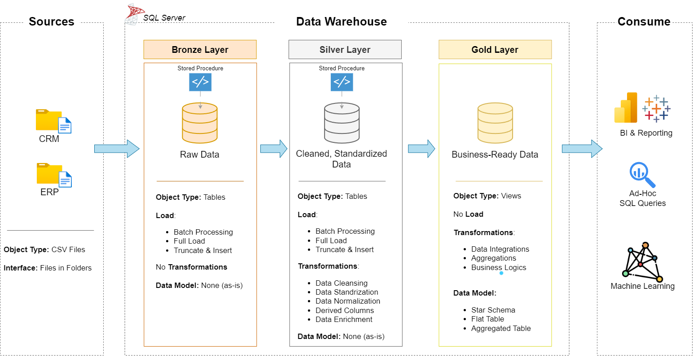

# Building a Data Warehouse using SQL (Data Engineering Project)

### Objective
Develop a modern data warehouse using SQL Server to consolidate sales data, enabling analytical reporting and informed decision-making.

### Specifications
- **Data Sources**: Import data from two source systems (ERP and CRM) provided as CSV files.
- **Data Quality**: Cleanse and resolve data quality issues prior to analysis.
- **Integration**: Combine both sources into a single, user-friendly data model designed for analytical queries.
- **Scope**: Focus on the latest dataset only; historization of data is not required.
- **Documentation**: Provide clear documentation of the data model.

```
sql-data-warehouse-project/
├── datasets/               the six source files needed in this project
│   ├── source_crm/         three files from the CRM system
│   └── source_erp/         three files from the ERP system
├── docs/                   documentation of the project
├── scripts/                the project scripts
│   ├── init_database.sql   creates the database
│   ├── bronze/             loads the raw files
│   ├── silver/             cleans and prepares the data
│   └── gold/               builds the tables for analysis
└── tests/                  checks the quality of the silver and gold data
```

In order to read the six files correctly, you should change the six paths in `scripts/bronze/proc_load_bronze.sql`.

---
## 🏗️ Data Architecture

The data architecture for this project follows Medallion Architecture **Bronze**, **Silver**, and **Gold** layers:


1. **Bronze Layer**: Stores raw data as-is from the source systems. Data is ingested from CSV Files into SQL Server Database.
2. **Silver Layer**: This layer includes data cleansing, standardization, and normalization processes to prepare data for analysis.
3. **Gold Layer**: Business-ready data modeled into a star schema required for reporting and analytics.

---
## 📖 Project Overview

In this project :

1. **Design the architecture:** a modern data warehouse with three layers, bronze, silver and gold.
2. **Build the ETL pipelines:** load the source files and move the data through the layers.
3. **Model the data:** facts and dimensions, ready for reports.
4. **Analyze it:** answer business questions with SQL.
